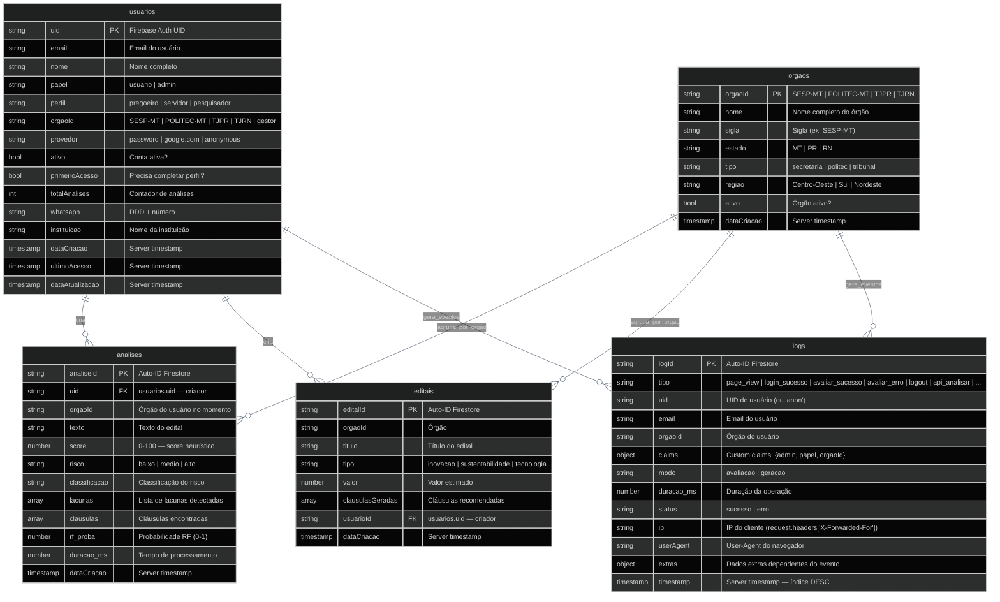

# Diagrama 07 — Schema do Firestore + Índices

**Collections:** `usuarios/`, `orgaos/`, `editais/`, `analises/`, `logs/`

## Índices Compostos (firestore.indexes.json)

```mermaid
%%{init: {'theme':'dark', 'themeVariables': {'primaryColor':'#1E293B','primaryTextColor':'#F1F5F9','primaryBorderColor':'#2EC4B6','lineColor':'#475569'}}}%%
flowchart LR
    subgraph IDX["📑 Composite Indexes — firestore.indexes.json"]
        direction TB
        I1["Collection: analises<br/>Fields: orgaoId ASC + dataCriacao DESC<br/>Query: WHERE orgaoId==? ORDER BY dataCriacao DESC"]
        I2["Collection: analises<br/>Fields: uid ASC + dataCriacao DESC<br/>Query: WHERE uid==? ORDER BY dataCriacao DESC"]
        I3["Collection: editais<br/>Fields: orgaoId ASC + dataCriacao DESC<br/>Query: WHERE orgaoId==? ORDER BY dataCriacao DESC"]
        I4["Collection: editais<br/>Fields: usuarioId ASC + dataCriacao DESC<br/>Query: WHERE usuarioId==? ORDER BY dataCriacao DESC"]
        I5["Collection: logs<br/>Fields: orgaoId ASC + timestamp DESC<br/>Query: WHERE orgaoId==? ORDER BY timestamp DESC"]
        I6["Collection: logs<br/>Fields: uid ASC + timestamp DESC<br/>Query: WHERE uid==? ORDER BY timestamp DESC"]
        I7["Collection: logs<br/>Fields: tipo ASC + timestamp DESC<br/>Query: WHERE tipo==? ORDER BY timestamp DESC"]
    end
    style IDX fill:#1E293B,stroke:#8B5CF6,color:#F1F5F9
```

**Tags de arquivo:** `docs/diagrams/07-firestore-schema.md`
