# Diagrama 08 — Sistema de Telemetria e Eventos

**Funções:** `registrarEvento(tipo, dados)` em `firebase-init.js` → `logs/` no Firestore

```mermaid
%%{init: {'theme':'dark', 'themeVariables': {'primaryColor':'#1E293B','primaryTextColor':'#F1F5F9','primaryBorderColor':'#2EC4B6','lineColor':'#475569'}}}%%
flowchart TB
    subgraph COLLECT["📡 COLETA DE EVENTOS"]
        direction TB
        E1["🌐 Landing Page<br/>/index.html"]
        E2["📊 Módulo Avaliação<br/>/modulo_avaliacao/"]
        E3["📝 Módulo Geração<br/>/modulo_geracao/"]
        E4["🖥️ Dashboard<br/>/dashboard/"]
        E5["🔐 auth.js<br/>onAuthStateChanged"]
    end

    subgraph EVENTS["📋 TIPOS DE EVENTO (TIPOS_EVENTO_VALIDOS)"]
        direction TB
        subgraph AUTH_EVT["🔐 Auth"]
            A1["login_sucesso"]
            A2["login_erro"]
            A3["login_anonimo"]
            A4["cadastro_sucesso"]
            A5["cadastro_erro"]
            A6["logout"]
            A7["perfil_atualizado"]
            A8["primeiro_acesso"]
        end
        subgraph NAV_EVT["🧭 Navegação"]
            N1["page_view"]
        end
        subgraph AVAL_EVT["📊 Avaliação"]
            V1["avaliar_click"]
            V2["avaliar_inicio"]
            V3["avaliar_sucesso"]
            V4["avaliar_erro"]
            V5["exemplo_selecionado"]
        end
        subgraph GER_EVT["📝 Geração"]
            G1["gerar_click"]
            G2["gerar_inicio"]
            G3["gerar_sucesso"]
            G4["gerar_erro"]
            G5["carregar_exemplo"]
        end
        subgraph SYS_EVT["⚙️ Sistema"]
            S1["erro_js"]
            S2["api_timeout"]
        end
    end

    subgraph REGISTRAR["📝 registrarEvento(tipo, dados)"]
        R1["sanitizeForLog(dados)<br/>Remove: passwords, tokens,<br/>PII sensível"]
        R1 --> R2["Captura automático:<br/>uid, email, orgaoId<br/>(via PubliAuth)"]
        R2 --> R3["Captura contexto:<br/>timestamp, ip, userAgent,<br/>document.referrer"]
        R3 --> R4["Firestore: add(logs/{id}, {<br/>  tipo, uid, email, orgaoId,<br/>  claims, duracao_ms,<br/>  status, ip, userAgent,<br/>  extras, timestamp<br/>})"]
        R4 --> R5["⚠️ Best-effort:<br/>nunca lança exceção<br/>Não bloqueia a UI"]
    end

    subgraph CONSUMERS["🎯 CONSUMIDORES DOS LOGS"]
        C1["📊 Dashboard Admin<br/>Lê logs/ (admin only)<br/>Tabela de eventos + CSV"]
        C2["☁️ Cloud Function<br/>Lê logs/ para<br/>audit trail interno"]
        C3["📈 Métricas 24h<br/>COUNT(tipo) recent<br/>Cards do dashboard"]
    end

    %% Conexões
    E1 -->|page_view| REGISTRAR
    E2 -->|avaliar_*| REGISTRAR
    E2 -->|exemplo_selecionado| REGISTRAR
    E3 -->|gerar_*| REGISTRAR
    E3 -->|carregar_exemplo| REGISTRAR
    E4 -->|page_view| REGISTRAR
    E5 -->|auth events| REGISTRAR

    R4 -.->|read (admin)| C1
    R4 -.->|read| C2
    R4 -.->|aggregate| C3

    style COLLECT fill:#1E293B,stroke:#2EC4B6,color:#F1F5F9
    style EVENTS fill:#1E293B,stroke:#F59E0B,color:#F1F5F9
    style REGISTRAR fill:#1E293B,stroke:#8B5CF6,color:#F1F5F9
    style CONSUMERS fill:#1E293B,stroke:#22C55E,color:#F1F5F9
    style AUTH_EVT fill:#0F172A,stroke:#2EC4B6,color:#94A3B8
    style NAV_EVT fill:#0F172A,stroke:#2EC4B6,color:#94A3B8
    style AVAL_EVT fill:#0F172A,stroke:#F59E0B,color:#94A3B8
    style GER_EVT fill:#0F172A,stroke:#F59E0B,color:#94A3B8
    style SYS_EVT fill:#0F172A,stroke:#EF4444,color:#94A3B8
```

## Estrutura do Documento em `logs/`

```mermaid
%%{init: {'theme':'dark', 'themeVariables': {'primaryColor':'#1E293B','primaryTextColor':'#F1F5F9','primaryBorderColor':'#2EC4B6','lineColor':'#475569'}}}%%
flowchart LR
    subgraph LOG_DOC["📄 Documento — logs/{autoId}"]
        direction TB
        L1["tipo: string<br/><span style='color:#2EC4B6'>'avaliar_sucesso'</span>"]
        L2["uid: string<br/><span style='color:#F59E0B'>'48uNDUq7BaPqa2OdPr1gtdWhPXw2'</span>"]
        L3["email: string<br/><span style='color:#94A3B8'>'sesp-teste@sesp.mt.gov.br'</span>"]
        L4["orgaoId: string<br/><span style='color:#2EC4B6'>'SESP-MT'</span>"]
        L5["claims: object<br/>{ admin:false, papel:'pregoeiro',<br/>orgaoId:'SESP-MT' }"]
        L6["duracao_ms: number<br/>{ ex: 1247.53 }"]
        L7["status: string<br/>'sucesso' | 'erro'"]
        L8["ip: string<br/>'189.45.123.45'"]
        L9["userAgent: string<br/>'Mozilla/5.0...'"]
        L10["extras: object<br/>{ score:72.5, risco:'medio',<br/>lacunasQtd:4 }"]
        L11["timestamp: timestamp<br/>Server timestamp"]
    end
    style LOG_DOC fill:#1E293B,stroke:#8B5CF6,color:#F1F5F9
```



**Tags de arquivo:** `docs/diagrams/08-telemetria.md`
